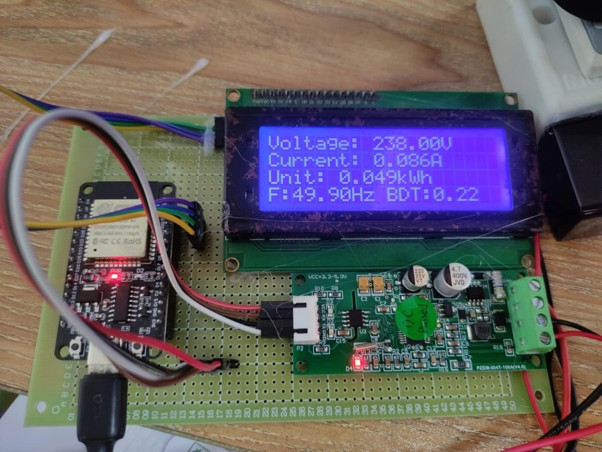
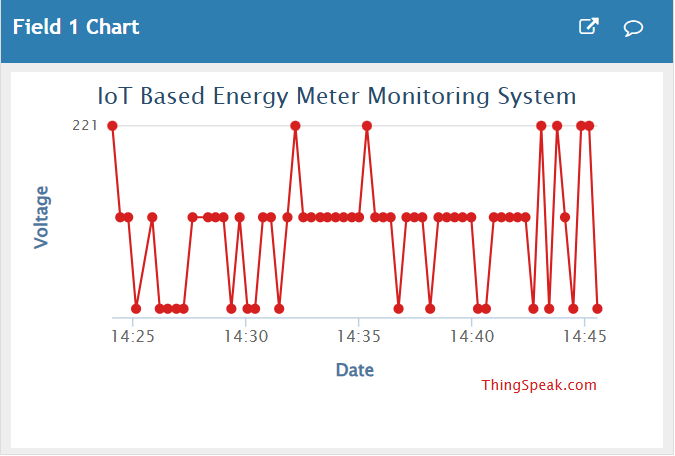
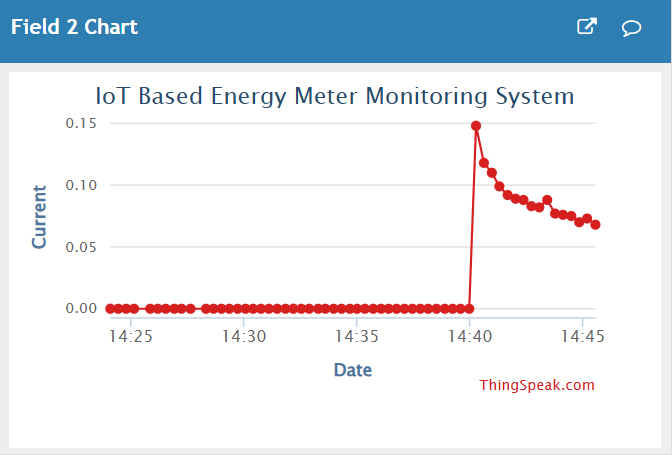
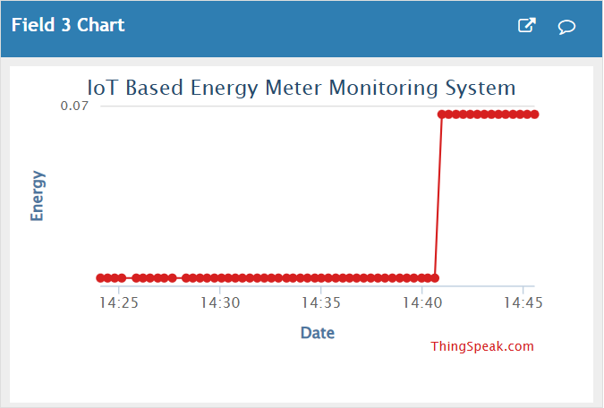
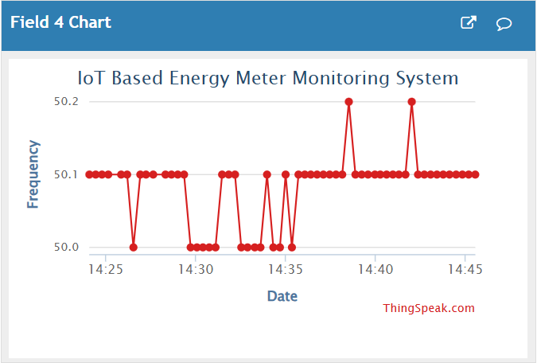
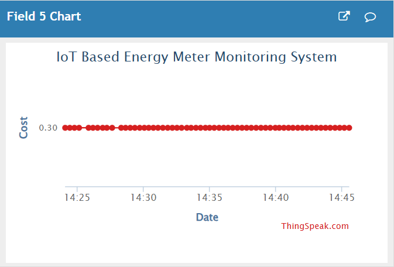

<div align="center">

# ⚡ IoT-Based Energy Meter Monitoring System

### Real-Time Electricity Monitoring • IoT • Embedded Systems • ThingSpeak Cloud

An IoT-based smart energy monitoring system designed to measure electrical parameters in real time and provide remote visibility into electricity consumption through the ThingSpeak IoT cloud platform.

<br>


<br>

**Developed by Md. Sakib Al-Hasan**

</div>

---

# 📌 Project Overview

The **IoT-Based Energy Meter Monitoring System** is designed to monitor electrical energy usage and make consumption information remotely accessible through IoT connectivity.

The system collects electrical measurements using an energy-metering module, processes the readings through an **ESP32 microcontroller**, and transmits monitoring data to **ThingSpeak** through Wi-Fi for cloud-based visualization and remote observation.

The project demonstrates the integration of:

- ⚡ Electrical energy measurement
- 🔌 Embedded hardware
- 🧠 ESP32-based data processing
- 📡 Wi-Fi connectivity
- ☁️ ThingSpeak IoT cloud integration
- 📊 Real-time monitoring
- 🌐 Remote data visualization

---

# 🎯 Project Objective

Traditional electricity meters generally require users to observe consumption information directly from the physical meter.

This project explores a connected monitoring approach where electrical measurements can be collected electronically, processed by an embedded controller, and transmitted to an IoT cloud platform for remote monitoring.

The primary objectives are:

- Measure important electrical parameters
- Monitor electricity consumption in real time
- Process measurement data using an embedded controller
- Transmit monitoring information through Wi-Fi
- Send energy data to ThingSpeak
- Visualize electrical measurements remotely
- Provide improved visibility into electricity usage
- Demonstrate an IoT-based smart energy monitoring architecture

---

# ✨ Key Features

```text
⚡ Real-Time Energy Monitoring
📈 Voltage Monitoring
🔌 Current Monitoring
🔋 Energy Consumption Tracking
〰️ Frequency Monitoring
💰 Electricity Cost Monitoring
🧠 ESP32-Based Processing
📡 Wi-Fi Connectivity
☁️ ThingSpeak IoT Cloud Integration
📊 Cloud Data Visualization
🌐 Remote Energy Monitoring
🔧 Embedded System Integration
```

---

# 🏗️ System Architecture

```text
                 ELECTRICAL LOAD
                        │
                        ▼
               ┌─────────────────┐
               │ Energy Metering │
               │     Module      │
               └────────┬────────┘
                        │
                        │ Electrical Measurements
                        ▼
               ┌─────────────────┐
               │      ESP32      │
               │ Microcontroller │
               └────────┬────────┘
                        │
                        │ Data Processing
                        ▼
               ┌─────────────────┐
               │      Wi-Fi      │
               │  Communication  │
               └────────┬────────┘
                        │
                        │ Internet
                        ▼
               ┌─────────────────┐
               │    ThingSpeak   │
               │    IoT Cloud    │
               └────────┬────────┘
                        │
                        ▼
               ┌─────────────────┐
               │     Remote      │
               │  Visualization  │
               └─────────────────┘
```

### Architecture Principle

> **Measure → Process → Connect → Upload → Visualize**

The architecture combines electrical measurement hardware, embedded processing, Wi-Fi communication, and cloud visualization to make electricity-consumption information remotely accessible.

---

# 🛠️ Technologies & Components

## 🧠 ESP32 Microcontroller

The **ESP32** acts as the primary processing and communication controller of the system.

Its responsibilities include:

- Reading electrical measurement data
- Processing collected values
- Managing Wi-Fi connectivity
- Preparing monitoring data
- Transmitting data to ThingSpeak
- Supporting continuous energy monitoring

---

## ⚡ Energy Measurement

The energy-metering component collects electrical measurements from the monitored electrical system.

The collected information is processed by the ESP32 before being transmitted to the cloud monitoring platform.

---

## 📡 Wi-Fi Connectivity

Wi-Fi provides the communication layer between the ESP32 and ThingSpeak.

```text
ESP32
  │
  ▼
Wi-Fi Network
  │
  ▼
Internet
  │
  ▼
ThingSpeak
```

This enables monitoring information to be transmitted without requiring direct access to the physical energy meter.

---

## ☁️ ThingSpeak IoT Cloud

**ThingSpeak** is used as the IoT cloud platform for receiving and visualizing energy-monitoring data transmitted by the ESP32.

The integration provides:

- Cloud-based data collection
- Remote monitoring
- Real-time data visualization
- Electrical parameter tracking
- Internet-accessible monitoring
- Historical observation of transmitted measurements

The ESP32 processes the electrical measurements and sends the resulting monitoring data to ThingSpeak through the network connection.

---

# 🔄 System Workflow

```text
Electrical Load
      │
      ▼
Electrical Measurement
      │
      ▼
Energy Metering Module
      │
      ▼
ESP32
      │
      ▼
Data Processing
      │
      ▼
Wi-Fi Communication
      │
      ▼
Internet
      │
      ▼
ThingSpeak IoT Cloud
      │
      ▼
Cloud Visualization
      │
      ▼
Remote Monitoring
```

The workflow creates an IoT monitoring pipeline from physical electrical measurements to remotely accessible monitoring information.

---

# 📊 Monitored Information

The implemented system provides cloud visualization for important energy-monitoring information.

| Measurement | Purpose |
|---|---|
| **Voltage** | Observes electrical supply voltage |
| **Current** | Tracks electrical current |
| **Energy** | Monitors accumulated energy consumption |
| **Frequency** | Observes electrical supply frequency |
| **Cost** | Provides electricity-cost monitoring based on energy usage |

The ThingSpeak dashboard provides a visual representation of these measurements over time.

---

# 📸 Project Showcase

## 🔧 Final Hardware Implementation

The following image shows the physical implementation of the IoT-Based Energy Meter Monitoring System.

<div align="center">



</div>

---

## ☁️ ThingSpeak Cloud Monitoring

The ESP32 transmits monitoring information through Wi-Fi to **ThingSpeak**, where the collected data can be remotely visualized.

### ⚡ Voltage Monitoring

<div align="center">



</div>

### 🔌 Current Monitoring

<div align="center">



</div>

### 🔋 Energy Monitoring

<div align="center">



</div>

### 〰️ Frequency Monitoring

<div align="center">



</div>

### 💰 Electricity Cost Monitoring

<div align="center">



</div>

---

# 🔌 Hardware-to-Cloud Pipeline

One of the main engineering concepts demonstrated by this project is the complete flow of information from physical hardware to cloud visualization.

```text
REAL WORLD
    │
    ▼
Electrical Load
    │
    ▼
Energy Measurement
    │
    ▼
ESP32
    │
    ▼
Wi-Fi
    │
    ▼
Internet
    │
    ▼
ThingSpeak
    │
    ▼
Cloud Visualization
    │
    ▼
USER
```

This demonstrates practical **hardware–software–cloud integration** within an IoT system.

---

# 🌐 IoT Monitoring Concept

The project demonstrates how conventional energy monitoring can be extended through internet connectivity and cloud services.

```text
Physical Electricity Usage
           ↓
Electrical Measurement
           ↓
Embedded Processing
           ↓
Network Communication
           ↓
ThingSpeak IoT Cloud
           ↓
Cloud Visualization
           ↓
Remote Energy Monitoring
```

Instead of limiting monitoring information to a locally accessible physical device, the system enables measurements to be transmitted to the cloud and observed remotely.

---

# 💡 Applications

Potential applications of the system concept include:

- Residential energy monitoring
- Laboratory energy analysis
- Small-scale smart energy systems
- Educational IoT projects
- Electrical consumption studies
- Remote equipment monitoring
- Energy-awareness applications
- Smart electricity monitoring
- Connected electrical systems

---

# 🎓 Engineering Concepts Demonstrated

Developing this project provided practical exposure to:

```text
IoT System Design
Embedded Systems
ESP32 Development
Electrical Data Acquisition
Microcontroller Programming
Wi-Fi Communication
ThingSpeak IoT Cloud
Cloud Data Visualization
Real-Time Monitoring
Remote Data Monitoring
Hardware–Software Integration
Hardware-to-Cloud Communication
```

---

# 📁 Repository Structure

```text
Energy-Meter-Monitoring-System/
│
├── docs/
│   └── screenshots/
│       ├── 01-final-project.jpg
│       ├── 02-thingspeak-voltage.jpg
│       ├── 03-thingspeak-current.jpg
│       ├── 04-thingspeak-energy.jpg
│       ├── 05-thingspeak-frequency.jpg
│       └── 06-thingspeak-cost.jpg
│
├── Source Code
├── Project Documentation
├── Originality / Supporting Documentation
└── README.md
```

> Repository contents may include implementation files and supporting academic project documentation in addition to the showcase assets above.

---

# 🚀 Future Improvements

Possible future enhancements include:

- Historical energy-consumption analysis
- Improved monitoring dashboards
- Usage alerts and notifications
- Automated energy-consumption reports
- Multi-device monitoring
- Advanced cloud visualization
- Extended energy analytics
- Threshold-based alerts
- Mobile monitoring interface
- Additional smart-energy functionality

---

# 👨‍💻 Developer

<div align="center">

## Md. Sakib Al-Hasan

### Software Developer | Full-Stack Developer | Backend Developer

**B.Sc. in Computer Science & Engineering**

<br>

[](https://www.linkedin.com/in/r-talukder66/)
[](https://github.com/sakib-rone66)
[](mailto:info.sakib.bluesec@gmail.com)

</div>

---

<div align="center">

# ⚡ Measure • Connect • Monitor • Improve

### From Electrical Measurements to Cloud-Based Energy Monitoring

**ESP32 • Wi-Fi • ThingSpeak • IoT**

<br>

⭐ **Thanks for exploring the IoT-Based Energy Meter Monitoring System**

</div>
